# rex-to-nvim

A tiny macOS app that opens code and text files in Neovim inside Rex.
Double-click a `.rs` file in Finder and it opens in Neovim: in the Neovim
you already have running for that git repository if there is one, otherwise in
a new Rex session at the repository root.



The app shows up in Finder as **Neovim**. It handles ~220 code file types,
plain text, and files without an extension, gives each one an icon, and never stays running: it has no Dock icon and no
windows, hands each file off to Rex, and quits.

rex-to-nvim is not affiliated with the Neovim project.

## Requirements

- An Apple Silicon Mac running macOS 13 or later
- Rex, with its app running
- [Neovim](https://neovim.io), on the `PATH` of your login shell
- The Xcode Command Line Tools (`xcode-select --install`) to build it

## Install

```sh
git clone https://github.com/amadeus/rex-to-nvim
cd rex-to-nvim
make install
```

This builds `Neovim.app` and installs it to `/Applications` (set
`INSTALL_DIR=…` to change that). `make uninstall` removes it and unregisters
its file types.

There's no prebuilt download; the app is built and signed locally, so macOS
doesn't quarantine it.

## Using it

**File types only this app knows** (`.rs`, `.go`, `.vue`, `.astro`, …) open in
it as soon as it's installed: it declares those types itself.

**File types other apps also handle** (`.ts`, `.json`, `.md`, `.swift`, `.svg`,
`.txt`, …) stay with their current app. The app only lists itself as an alternative,
so it appears in **Open With** but doesn't take them over. To switch one,
select a file of that type in Finder, then **Get Info → Open with: Neovim →
Change All…**

**Plain text and files without an extension** work the same way:
- **Get Info → Change All** on a `.txt` file makes Neovim the default for
  everything macOS identifies as plain text, including `.text` and `README`.
  Types with their own default, like `.csv` in Numbers, keep it.
- Doing it on a dotfile like `.zshrc` makes Neovim the default for every file
  macOS can't type: dotfiles, files without an extension, and files with an
  extension it doesn't know. Binary ones among them are passed on to the
  next app that can open them (TextEdit, usually), or shown in Finder.

Opening the app on its own does nothing.

## What happens when you open a file

1. The working directory is the root of the file's git repository, or the
   file's own folder if it isn't in one.
2. If the file is in a git repository and a Rex pane is already running Neovim
   in that repository, the file opens there (`:tab drop`, which switches to it
   if it's already open), and Rex switches to that pane. A Neovim at the
   repository root is preferred over one in a subfolder.
3. Otherwise it creates a Rex session in the working directory and types
   `nvim -p <files>` into its shell, so quitting Neovim leaves you at a prompt
   instead of closing the session.
4. Rex comes to the front.

Several files from the same repository opened at once go to one Neovim, as
tabs. A forward takes about a third of a second.

## Configuration

Optional, in `~/.config/rex-to-nvim/config.json`:

```json
{
  "command": ["nvim", "-p", "{files}"],
  "reuseNvim": true
}
```

| Key | Default | Meaning |
| --- | --- | --- |
| `command` | `["nvim", "-p", "{files}"]` | What a new session runs. `{files}` expands to every opened path, `{file}` to the first. |
| `cwd` | `"gitRoot"` | `"gitRoot"`, or `"parent"` to always use the file's folder. |
| `keepShell` | `true` | Run the command from a shell. `false` runs it directly, so quitting it ends the session. |
| `reuseNvim` | `true` | Open files from a git repository in a Neovim already running in it. |
| `openCommand` | `"tab drop"` | The Ex command a reused Neovim opens each file with, e.g. `"drop"` or `"edit"`. |
| `client` | `"auto"` | Which Rex app to switch to the session: `"auto"` (this Mac), `"none"`, or a client label or ID from `rex client ls`. |
| `rex` | found automatically | Path to the `rex` binary. By default it's looked up on `PATH`, then in the newest Rex server install. |

## Privacy

To find a running Neovim, the app reads the working directory and environment
of your own `nvim` processes. It only uses `REX_SESSION`, `REX_BLOCK`,
`XDG_RUNTIME_DIR` and `TMPDIR` from the environment, and stores nothing.
The log, `~/Library/Logs/rex-to-nvim.log`, records which files were opened
where. It's capped at 1 MB, plus one previous file.

## Troubleshooting

- **Nothing happens when I open a file.** Check
  `~/Library/Logs/rex-to-nvim.log`; the app never shows errors on screen.
- **Files don't open in my running Neovim.** It has to be the foreground
  program of a Rex pane, started from that pane's shell, with its working
  directory inside the file's repository.
- **Old icons in Finder.** macOS caches icons aggressively. Run
  `killall iconservicesagent Finder`, or log out and back in.
- **Neovim is listed for `.ts` and `.mts` videos.** macOS identifies those
  extensions as MPEG-2 video, so claiming TypeScript claims them too. It doesn't
  become their default unless you make it.

## Which file types it claims

The code extensions in `data/extensions.txt`, plus the whole types in
`data/content-types.txt`: plain text, and generic data for files without an
extension. Edit either file and run `make install` to change what's claimed.

Each extension maps to the type macOS already uses for it, or the app declares
one if macOS doesn't know it. The build refuses extensions macOS maps to a
catch-all type like plain text; those belong in `content-types.txt`, where
it's clear the whole type is being claimed.

Names, glyphs and colors come from
[nvim-web-devicons](https://github.com/nvim-tree/nvim-web-devicons), snapshotted
in `data/devicons.json`. To refresh it from your installed plugin:

```sh
make devicons   # or: make devicons DEVICONS=/path/to/nvim-web-devicons
```

## Development

```
Sources/main.swift          the app: receives open events, finds Neovims, drives the rex CLI
tools/gen-plist.swift       extensions.txt + content-types.txt + devicons.json → Info.plist
tools/gen-icons.swift       types.json → AppIcon.icns + one .icns per file type
tools/export-devicons.lua   nvim-web-devicons → data/devicons.json
data/                       extensions.txt and content-types.txt (what to claim), devicons snapshot
assets/fonts/               Symbols Nerd Font, for the document icon glyphs
```

`APP_NAME`, `BUNDLE_ID` and `INSTALL_DIR` can be overridden on the `make`
command line. [AGENTS.md](AGENTS.md) has notes on testing and on the macOS
quirks this project works around.

## License

MIT; see [LICENSE](LICENSE). Bundled and derived third-party works (the Neovim
logo, nvim-web-devicons, Symbols Nerd Font) are covered in
[THIRD_PARTY_NOTICES.md](THIRD_PARTY_NOTICES.md).
